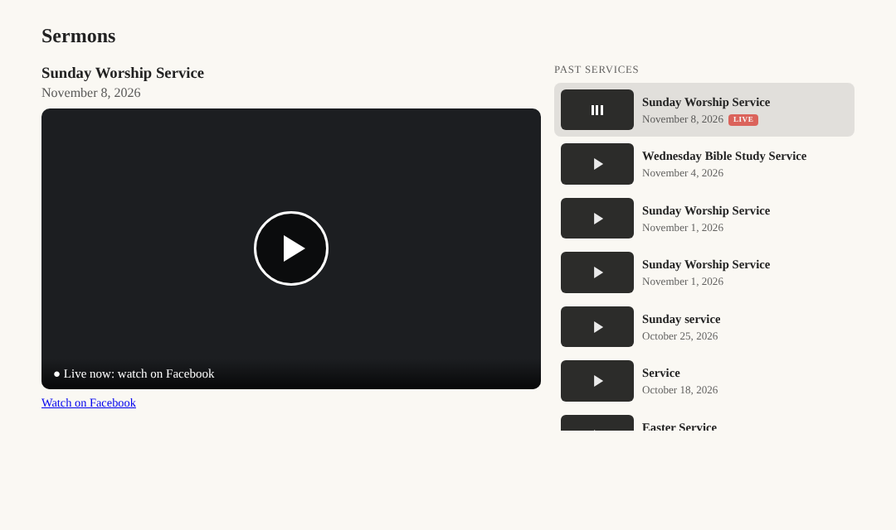
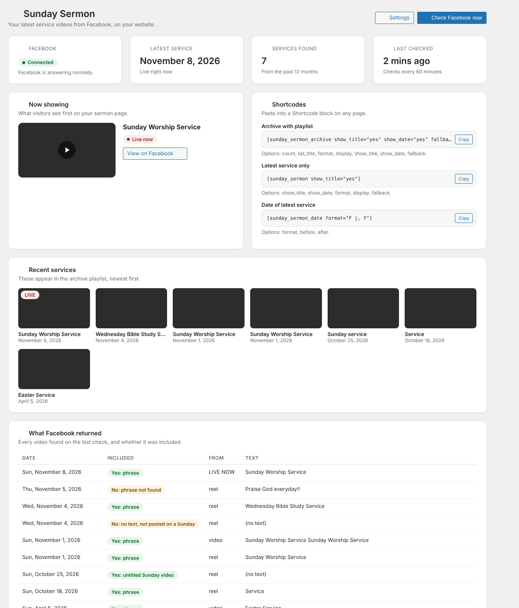
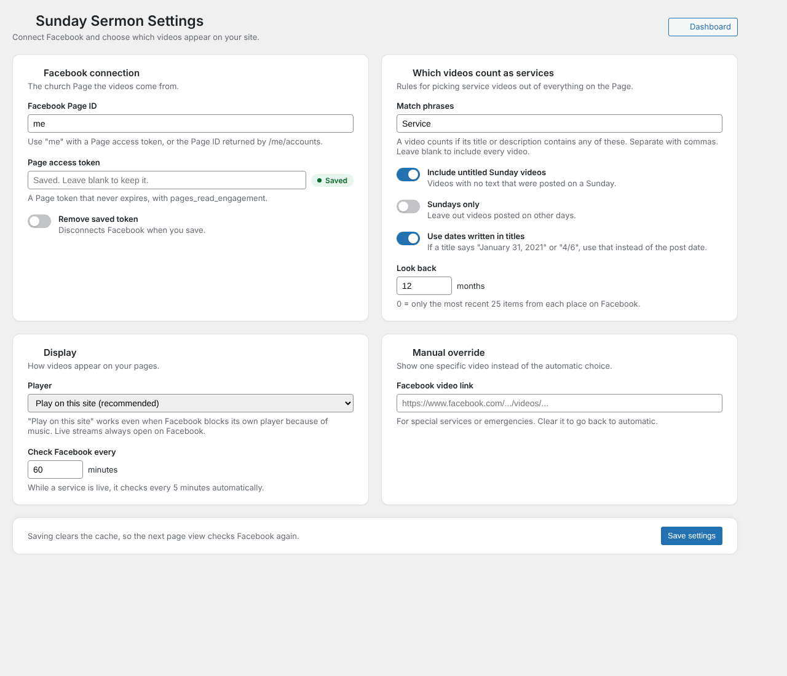
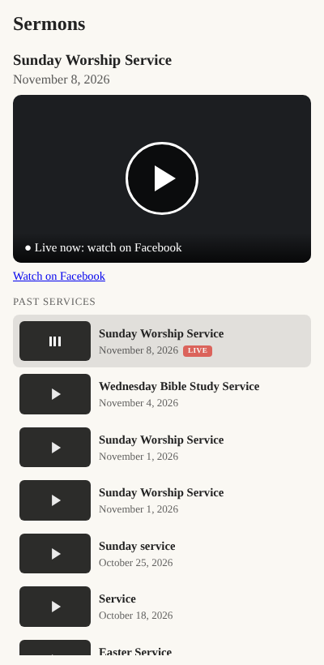

# Sunday Sermon Facebook Video

A WordPress plugin that automatically pulls your church's service videos from its Facebook Page (videos, Reels, live streams and video posts) and shows them on your church website, with a playlist of past services.



## Features

- **Automatic:** checks your Facebook Page every hour (every 5 minutes while a service is live) and always shows the newest service.
- **Plays on your site:** plays the video file directly, so it works even when Facebook's own player blocks the video because of worship music.
- **Finds services, skips the rest:** matches by phrases like `Sunday Worship Service`, untitled videos posted on Sundays, or Sundays only.
- **Reads dates from titles:** a post titled "Service from 4/6" is filed under April 6, not the day it was uploaded.
- **Archive with playlist:** the latest service with a "Past services" list beside it; stacks under the player on phones.
- **Live streams:** shows a live service with a LIVE tag, then switches to the recording.
- **Never goes blank:** if Facebook can't be reached, visitors keep seeing the last video that loaded.
- **Admin dashboard:** connection status, what's showing, copy-ready shortcodes, and a table showing every video Facebook returned and why it was or wasn't included.

## Requirements

- WordPress 6.0 or later, PHP 7.4 or later
- A Facebook account with **full control** of the church's Facebook Page
- A free Meta developer app (Development mode is fine; no app review needed)
- Service videos posted **as the Page**, not on a personal profile

## Installation

1. Download the latest release zip (or **Code → Download ZIP**).
2. In WordPress, go to **Plugins → Add New → Upload Plugin**, choose the zip, then **Install Now** and **Activate**.
3. Set **Settings → General → Timezone** to your church's city.
4. Go to **Sunday Sermon → Settings** and add your Facebook Page access token (see below).
5. Add a **Shortcode** block to a page with:

   ```
   [sunday_sermon_archive show_title="yes" show_date="yes" fallback="Check back Sunday afternoon."]
   ```

## Getting a Page access token that never expires

1. Create an app at [developers.facebook.com](https://developers.facebook.com) (**My Apps → Create App**; leave it in Development mode).
2. In the [Graph API Explorer](https://developers.facebook.com/tools/explorer), choose your app, **Get User Access Token** with `pages_show_list` and `pages_read_engagement`, and select your church Page in the pop-up.
3. Click the **ⓘ** next to the token → **Open in Access Token Tool** → **Extend Access Token**. Copy the extended token.
4. Open this address in a browser tab, replacing `LONG_TOKEN` with the extended token:

   ```
   https://graph.facebook.com/me/accounts?fields=id,name,access_token&access_token=LONG_TOKEN
   ```

5. Copy the `access_token` next to your church Page's name.
6. Check it in the [Access Token Debugger](https://developers.facebook.com/tools/debug/accesstoken): it must say **Type: Page** and **Expires: Never**.
7. Paste it into **Sunday Sermon → Settings**, save, then click **Check Facebook now** on the Dashboard.

The token stops working if that Facebook account changes its password or loses full control of the Page. If that happens, the Dashboard shows the error and visitors keep seeing the last good video; repeat the steps above.

## Shortcodes

| Shortcode | Shows | Options |
| --- | --- | --- |
| `[sunday_sermon_archive]` | Player with a playlist of past services | `count` (default 8, max 100), `show_title`, `show_date`, `list_title`, `format`, `display`, `fallback`, `match` |
| `[sunday_sermon]` | The latest service only | `show_title`, `show_date`, `format`, `display`, `fallback`, `match` |
| `[sunday_sermon_date]` | The latest service's date | `format`, `before`, `after`, `match` |

`format` uses [WordPress date codes](https://wordpress.org/documentation/article/customize-date-and-time-format/), e.g. `F j, Y`. `display` is one of `native` (play on site), `auto`, `embed` (Facebook player) or `thumbnail` (opens Facebook).

## Screenshots

| Dashboard | Settings |
| --- | --- |
|  |  |



## Troubleshooting

| Message | Fix |
| --- | --- |
| Invalid OAuth 2.0 Access Token | The token expired. Get a new one and confirm **Expires: Never** before saving. |
| Tried accessing nonexisting field (videos / video_reels) | Set Page ID to `me` and make sure the token's type is **Page**, not User. |
| `me/accounts` returns an empty list | Regenerate the user token and tick your Page in the pop-up; check you have full control. |
| No recent video matched | Look at **What Facebook returned** on the Dashboard and adjust the match phrases. |
| "This video can't be embedded" | Set **Player** to **Play on this site**. |

## External services

This plugin connects to Meta's [Facebook Graph API](https://developers.facebook.com/docs/graph-api/) (`graph.facebook.com`) using the Page access token you provide, to list your Page's videos, Reels, live videos and posts. Requests are made from your server on a schedule and when an administrator clicks **Check Facebook now**. Video files, thumbnails and the optional Facebook player are loaded from Facebook's servers in your visitors' browsers. See Meta's [Terms](https://www.facebook.com/terms.php) and [Privacy Policy](https://www.facebook.com/privacy/policy/).

## License

GPL-2.0-or-later. See [LICENSE](LICENSE).

Copyright © 2026 avdude
