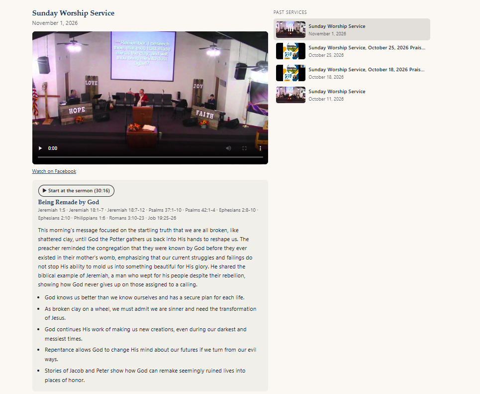

# Sunday Sermon Facebook Video

A WordPress plugin that automatically pulls your church's service videos from its Facebook Page (videos, Reels, live streams and video posts) and shows them on your church website, with a playlist of past services.


## Features

- **Automatic:** checks your Facebook Page every hour (every 5 minutes while a service is live) and always shows the newest service.
- **Plays on your site:** plays the video file directly, so it works even when Facebook's own player blocks the video because of worship music.
- **Finds services, skips the rest:** matches by phrases like `Sunday Worship Service`, untitled videos posted on Sundays, or Sundays only.
- **Reads dates from titles:** a post titled "Service from 4/6" is filed under April 6, not the day it was uploaded.
- **Archive with playlist:** the latest service with a "Past services" list beside it; stacks under the player on phones.
- **Live streams:** shows a live service with a LIVE tag, then switches to the recording.
- **Never goes blank:** if Facebook can't be reached, visitors keep seeing the last video that loaded.
- **Sermon transcripts (optional):** sends each new service to [AssemblyAI](https://www.assemblyai.com) and shows a collapsible transcript under the video. Click a timestamp to jump to that moment. Transcripts can be corrected in WordPress.
- **Sermon summaries (optional):** an AI model, through AssemblyAI's LLM Gateway or Claude directly, finds where the sermon starts and ends inside the full service, then writes a summary, key points and the Bible passages used. Adds a "Start at the sermon" button and can trim the transcript to just the sermon.
- **Admin dashboard:** connection status, what's showing, copy-ready shortcodes, and a table showing every video Facebook returned and why it was or wasn't included.

## Requirements

- WordPress 6.0 or later, PHP 7.4 or later
- A Facebook account with **full control** of the church's Facebook Page
- A free Meta developer app (Development mode is fine; no app review needed)
- Service videos posted **as the Page**, not on a personal profile

## Installation

1. Download the latest release zip (or **Code → Download ZIP**).
2. In WordPress, go to **Plugins → Add New → Upload Plugin**, choose the zip, then **Install Now** and **Activate**.
3. Set **Settings → General → Timezone** to your church's city.
4. Go to **Sunday Sermon → Settings** and add your Facebook Page access token (see below).
5. Add a **Shortcode** block to a page with:

   ```
   [sunday_sermon_archive show_title="yes" show_date="yes" fallback="Check back Sunday afternoon."]
   ```

## Getting a Page access token that never expires

1. Create an app at [developers.facebook.com](https://developers.facebook.com) (**My Apps → Create App**; leave it in Development mode).
2. In the [Graph API Explorer](https://developers.facebook.com/tools/explorer), choose your app, **Get User Access Token** with `pages_show_list` and `pages_read_engagement`, and select your church Page in the pop-up.
3. Click the **ⓘ** next to the token → **Open in Access Token Tool** → **Extend Access Token**. Copy the extended token.
4. Open this address in a browser tab, replacing `LONG_TOKEN` with the extended token:

   ```
   https://graph.facebook.com/me/accounts?fields=id,name,access_token&access_token=LONG_TOKEN
   ```

5. Copy the `access_token` next to your church Page's name.
6. Check it in the [Access Token Debugger](https://developers.facebook.com/tools/debug/accesstoken): it must say **Type: Page** and **Expires: Never**.
7. Paste it into **Sunday Sermon → Settings**, save, then click **Check Facebook now** on the Dashboard.

The token stops working if that Facebook account changes its password or loses full control of the Page. If that happens, the Dashboard shows the error and visitors keep seeing the last good video; repeat the steps above.

## Transcripts (optional)

1. Create an account at [assemblyai.com](https://www.assemblyai.com) and copy your API key. AssemblyAI bills per hour of audio.
2. In **Sunday Sermon → Settings → Transcripts**, turn on transcripts and paste the key.
3. Choose whether new services are sent automatically (the 3 newest, once each), a monthly limit, the language, and any names or words to recognize (pastors' names, local places, Bible books).
4. The Dashboard's **Transcripts** card shows each service's status. Use **Transcribe** to send an older service by hand.
5. Finished transcripts appear under the player. Edit them under **Sunday Sermon → Transcripts**; keep the `[m:ss]` at the start of each paragraph so the timestamps keep working.

Transcripts need the video file from Facebook, so they work only for services posted as the Page, after a live stream has ended. Add `transcript="no"` to a shortcode to hide them.

## Sermon summaries (optional)

Needs transcripts turned on first.

1. In **Sunday Sermon → Settings → Transcripts → Sermon summaries**, turn summaries on and pick a **Provider**:
   - **AssemblyAI LLM Gateway** (default): uses the AssemblyAI key you already entered. Pick a model from the **AssemblyAI model** dropdown, which lists AssemblyAI's current models. Which models you can use depends on your AssemblyAI plan; a free account may only have access to Qwen3.5 4B Fast. The plugin trims long transcripts to fit smaller models.
   - **Claude, directly from Anthropic**: paste an API key from the [Claude Console](https://console.anthropic.com) and pick Claude Haiku 5.5 or Sonnet 5.5.
2. Each finished transcript is summarized automatically. The Dashboard's **Transcripts** card shows the status, with a **Summarize** button to run it again.
3. On the website, the summary appears above the transcript with a **Start at the sermon** button. With **Show only the sermon in the transcript** on, songs and announcements are hidden from the transcript.
4. Correct anything on the transcript's edit screen in the **Sermon summary** box: start and end times, title, summary, key points and scripture.



## Shortcodes

| Shortcode | Shows | Options |
| --- | --- | --- |
| `[sunday_sermon_archive]` | Player with a playlist of past services | `count` (default 8, max 100), `show_title`, `show_date`, `list_title`, `format`, `display`, `fallback`, `match`, `transcript` |
| `[sunday_sermon]` | The latest service only | `show_title`, `show_date`, `format`, `display`, `fallback`, `match`, `transcript` |
| `[sunday_sermon_date]` | The latest service's date | `format`, `before`, `after`, `match` |

`format` uses [WordPress date codes](https://wordpress.org/documentation/article/customize-date-and-time-format/), e.g. `F j, Y`. `display` is one of `native` (play on site), `auto`, `embed` (Facebook player) or `thumbnail` (opens Facebook).

## Screenshots

| Dashboard | Settings |
| --- | --- |
|  |  |


## Troubleshooting

| Message | Fix |
| --- | --- |
| Invalid OAuth 2.0 Access Token | The token expired. Get a new one and confirm **Expires: Never** before saving. |
| Tried accessing nonexisting field (videos / video_reels) | Set Page ID to `me` and make sure the token's type is **Page**, not User. |
| `me/accounts` returns an empty list | Regenerate the user token and tick your Page in the pop-up; check you have full control. |
| No recent video matched | Look at **What Facebook returned** on the Dashboard and adjust the match phrases. |
| "This video can't be embedded" | Set **Player** to **Play on this site**. |
| AssemblyAI: Your account does not have access to this LLM Gateway model | Pick another model in **AssemblyAI model**, add billing to your AssemblyAI account, or switch **Provider** to Claude. |
| Couldn't read the summary the AI model returned | Click **Summarize** again; small models sometimes reply in the wrong format. A larger model or Claude is more reliable. |

## External services

This plugin connects to Meta's [Facebook Graph API](https://developers.facebook.com/docs/graph-api/) (`graph.facebook.com`) using the Page access token you provide, to list your Page's videos, Reels, live videos and posts. Requests are made from your server on a schedule and when an administrator clicks **Check Facebook now**. Video files, thumbnails and the optional Facebook player are loaded from Facebook's servers in your visitors' browsers. See Meta's [Terms](https://www.facebook.com/terms.php) and [Privacy Policy](https://www.facebook.com/privacy/policy/).

If you turn on transcripts, the plugin also sends the address of each sermon's video file to [AssemblyAI](https://www.assemblyai.com) (`api.assemblyai.com`) using your API key, and downloads the finished transcript. AssemblyAI fetches and processes the audio. See AssemblyAI's [Terms](https://www.assemblyai.com/legal/terms-of-service) and [Privacy Policy](https://www.assemblyai.com/legal/privacy-policy).

If you turn on sermon summaries, the plugin sends each finished transcript's text, using your API key, to the provider you choose: AssemblyAI's [LLM Gateway](https://www.assemblyai.com/docs/llm-gateway/overview) (`llm-gateway.assemblyai.com`) or Anthropic's [Claude API](https://docs.claude.com) (`api.anthropic.com`), to find the sermon and write the summary. See Anthropic's [Commercial Terms](https://www.anthropic.com/legal/commercial-terms) and [Privacy Policy](https://www.anthropic.com/legal/privacy).

## License

GPL-2.0-or-later. See [LICENSE](LICENSE).

Copyright © 2026 avdude
